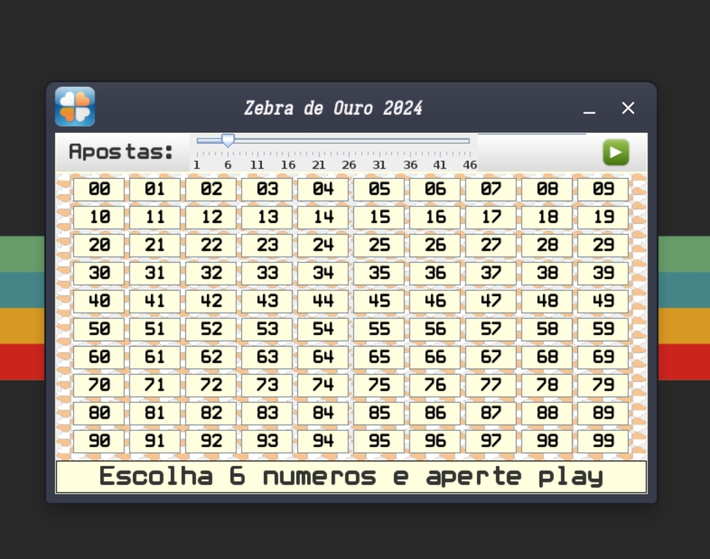
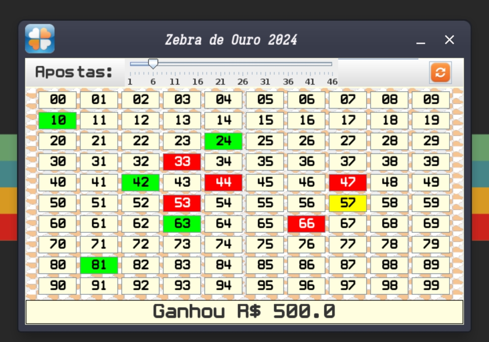

-----


-----

# Loto Fácil — Zebra de Ouro 2024

   



LotoFácil é um programa que simula um sorteio de loteria: você escolhe quantos números quiser e testa sua sorte em uma interface gráfica feita com **Java Swing**.

> 🎓 Projeto da disciplina **Linguagens de Programação** dos cursos de **Ciência da Computação**, **Sistemas de Informação** e **Análise e Desenvolvimento de Sistemas** do **Centro Universitário Newton Paiva**.
>
> - 2°Sem 2023
> - 1°Sem 2024

-----

## 📌 Sobre o projeto

Projeto desenvolvido pelo aluno **Randolfo A. Gonçalves** como extensão do projeto Lotofácil da disciplina.

- A janela **Zebra de Ouro 2024** exibe uma cartela com **100 números** (botões).
- O jogador marca os números desejados; para desmarcar uma casa, basta clicar nela novamente.
- Ao clicar em **Play**, o programa sorteia números distintos (em verde) e destaca em amarelo os acertos. O prêmio é de **R$ 500,00 por acerto**.
- O botão **Replay** reinicia a cartela para uma nova aposta.



Caso deseje alterar o número de casas a serem marcadas (de 1 a 46), use o **slider**:


## 🧠 Principais conceitos abordados

- **Interface gráfica com Swing** — `JFrame`, `JPanel`, `JButton`, `JLabel`, `JMenuBar` e `JSlider`
- **Classes internas** — a classe `Btn` estende `JButton` guardando o estado de seleção
- **Eventos** — tratamento de cliques e de mudança de valor do *slider*
- **Coleções** — `ArrayList<Integer>` para os números escolhidos e sorteados
- **Números aleatórios** — `Random.nextInt(origin, bound)` (API do Java 17) e sorteio sem repetição
- **Inferência de tipos** — uso de `var` em laços *for-each*
- **Recursos personalizados** — fontes TTF (`Font.createFont`), ícones e imagens de fundo
- **Pintura customizada** — sobrescrita de `paintComponent` na classe `Graph`
- **Automação de build** — `Makefile` para compilar, executar e empacotar em `.jar`

## 📁 Estrutura do projeto

```
Lotofacil_GUI/
├── Makefile
├── rec/
│   ├── fonts/
│   └── images/
└── src/
    ├── Fonts.java
    ├── Graph.java
    └── Main.java
```

## ☕ Versão do Java e tecnologias

| Item | Versão / Detalhe |
|------|------------------|
| Java (JDK) | **17 (LTS)** |
| IDE | IntelliJ IDEA (módulo `.iml`) |
| Build | GNU Make (`Makefile`) + `javac`/`jar` |
| GUI | Java Swing / AWT |

## ▶️ Como executar

> ℹ️ Este programa foi escrito para ser usado em um ambiente Linux; no entanto, o código-fonte está na pasta `src` para outros formatos de compilação.

**Linux / macOS** — dentro da pasta do projeto, digite:

```bash
# 1° passo: compilar
make

# 2° passo: executar
make run

# Caso queira gerar um arquivo .jar:
make jar
```

**Sem o `make`** (qualquer sistema, a partir da pasta do projeto):

```bash
javac -d .bin src/*.java
java -cp .bin Main
```

Após essa etapa o programa inicia sua execução: escolha seus números e aposte!

## 📚 Documentação e links úteis

- [☕ Documentação oficial do Java SE 17 (API)](https://docs.oracle.com/en/java/javase/17/docs/api/)
- [📘 The Java Tutorials (Oracle)](https://docs.oracle.com/javase/tutorial/)
- [📥 Download do JDK 17 (Eclipse Temurin)](https://adoptium.net/temurin/releases/?version=17)
- [💡 IntelliJ IDEA](https://www.jetbrains.com/pt-br/idea/)
- [🎨 Creating a GUI With Swing (Oracle)](https://docs.oracle.com/javase/tutorial/uiswing/)
- [🎚️ How to Use Sliders (JSlider)](https://docs.oracle.com/javase/tutorial/uiswing/components/slider.html)
- [🔧 GNU Make](https://www.gnu.org/software/make/manual/make.html)

## 👨‍🏫 Professor

**João Paulo Aramuni** — [GitHub](https://github.com/joaopauloaramuni)

## 📄 Licença

Este projeto está sob a licença **MIT**. Consulte o arquivo [LICENSE](https://github.com/joaopauloaramuni/linguagens-de-programacao/blob/main/LICENSE) na raiz do repositório para mais detalhes.

Copyright (c) 2024 João Paulo Aramuni
